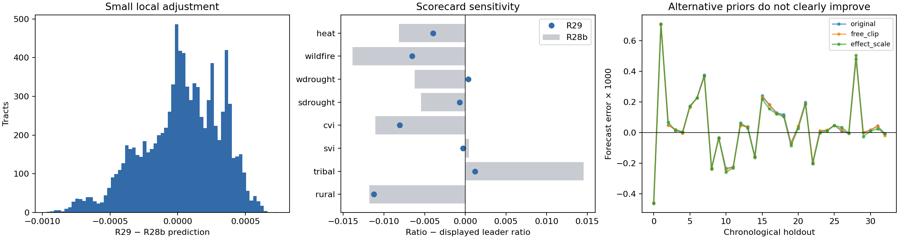

# R29 analysis — 2026-10-19

`submission_r29.csv` is a new **experimental local recalibration**, not a demonstrated
improvement. R28b remains the best confirmed result: **0.062097808**.
R29's public projection is **0.062097258** versus **0.062096889**
for R28b under the same estimator. The difference is below forecast error and does
not establish a public or private gain. The conservative recommendation is to retain
R28b as the known best and treat R29 as an optional scorecard-sensitive hedge.

## Data and validation limits

- 9,794 submission rows; 9,379 graded rows in four regions and 415 Eastern Washington rows
  held fixed. GEOIDs match all five official sample files exactly, including leading zeros.
- 60 scored historical files in the actual artifact (older prose says 61).
  There are no tract training labels. Historical predictions are features; an RMSE
  score is an aggregate observation, never a tract-level target.
- Cached permitted features contain 9,801 rows and 255 columns, no duplicate IDs,
  7 extra feature rows excluded by the official sample and no missing submitted IDs.
  Missingness and constant-column diagnostics are saved alongside this report.
- No withdrawn reference layer, external training dataset, paid model API, or AutoML
  service was used. Existing historical features were not rebuilt.
- Public scores and scorecard calibration remain adaptive feedback. The inherited
  assumption that a zero-scoring leader reveals true full-population ratios is not
  independently established by this run. Ratio definitions are inherited from R23/R24.
- The estimated public subset weights come from affine constraints available before
  the first holdout. Later scores never enter a chronological fold's fit or noise proxy.

## Skills installed and applied

Reviewed and installed `scikit-learn`, `statistical-analysis`, and `pymc` from
[K-Dense Scientific Agent Skills](https://github.com/K-Dense-AI/scientific-agent-skills),
alongside the existing `ml-analysis` workflow. They were selected for split design,
explicit measurement dependence, uncertainty checks and prior sensitivity. This is
a task-specific selection, not an objective ranking of all skills online.

The original coefficient prior, a learned clipping-direction prior, and an RMS-effect
prior were compared with hyperparameters refit from earlier scores for every holdout.
Gaussian conditioning is analytic in NumPy/SciPy; no MCMC was run. The installed PyMC
skill informed the generative-model and sensitivity checks. The skill's newer package
examples were not executed and the project's numerical environment was not upgraded.
Installed instruction hashes and review comparisons are in `summary.json`.

## Chronological score forecasting

All 33 files from p12 onward were forecast using only preceding scores. These evaluate
prediction of the next **public aggregate score**, not private tract RMSE. Conditional
95% interval coverage is diagnostic: fitted hyperparameter uncertainty, systematic
model error and adaptive submission design are not fully represented.

| mode | mae | rmse | bias | coverage95 |
| --- | --- | --- | --- | --- |
| effect_scale | 0.000145927 | 0.000219600 | 0.000041780 | 0.939393939 |
| free_clip | 0.000145136 | 0.000217243 | 0.000044392 | 0.878787879 |
| original | 0.000145185 | 0.000218123 | 0.000046427 | 0.909090909 |

Learned clipping prior MAE difference versus original: -0.000000049;
five-file moving-block bootstrap 95% descriptive interval
[-0.000001947, +0.000001695].
RMS-effect prior difference: +0.000000742; interval
[-0.000004326, +0.000005826].
Neither establishes a clear improvement. The RMS-effect fit also creates large raw
negative predictions; its attractive post-clipping projection is not sufficient
evidence to use it. All experiments, including rejected variants, are retained.

## New R29 file

R29 starts from the scored R28b predictions. It applies a local minimum-change solve
to all historical score moments and eight scorecard ratio constraints. Relative to
the earlier solve, the new uncertainty model:

1. Propagates uniform ±0.005 rounding uncertainty in the leader's ratio and both
   calibration ratios, rather than treating the two calibration ratios as exact.
2. Uses the full covariance from the same ungraded WA tracts contributing to multiple
   ratios, rather than treating those contributions as independent.
3. Fits a local tract adjustment scale by marginal likelihood and preserves clipping
   bounds and the five published Paradise values.

Because the incumbent already uses historical feedback, this is an empirical local
recalibration; it must not be interpreted as an independent Bayesian posterior.
Independent rounding errors and the common 0.0624 WA residual scale are modeling
assumptions; the covariance is an approximation, not an identified error model.
The chosen covariance model is the primary scientific specification, not the
variant with the lowest projected public score. Doubling rounding SD, halving or
doubling score noise, and diagonal covariance are recorded in `experiments.tsv`.
The eight single-stratum ablations and all local configurations are recorded in
`local_models.json`.

The final change has pi-weighted RMS **0.0002928**, maximum absolute
change **0.0009670**, and changes 9,293 rows after six-decimal rounding.
WA and the five published scores remain fixed. These are prediction changes, not
measured error reductions.

| stratum | n_high | n_low | leader_displayed | r28b | r29 |
| --- | --- | --- | --- | --- | --- |
| rural | 1853 | 7941 | 2.340000000 | 2.328226856 | 2.328757997 |
| tribal | 874 | 8920 | 2.880000000 | 2.894565048 | 2.881180042 |
| svi | 4971 | 4823 | 1.230000000 | 1.230470268 | 1.229706635 |
| cvi | 4896 | 4898 | 1.550000000 | 1.538924533 | 1.541917573 |
| sdrought | 4896 | 4898 | 1.000000000 | 0.994567304 | 0.999300645 |
| wdrought | 4896 | 4898 | 1.360000000 | 1.353788142 | 1.360358735 |
| wildfire | 4897 | 4897 | 1.770000000 | 1.756143419 | 1.763458717 |
| heat | 4965 | 4829 | 0.620000000 | 0.611862350 | 0.616039255 |

## Verification and reproduction

- Submission: exactly 9,794 unique GEOIDs, two required columns, no missing or
  infinite values, predictions in [0,1], all official sample IDs and anchors preserved.
- Original `solution.py` reproduced its tracked submissions and validation log with
  no tracked-file changes. The known-best file was not replaced.
- Basis reconstruction maximum absolute error: 1.26e-06.
- Perturbing R27's held-out score by +0.01 changed its preceding training moments
  by at most 1.71e-13; refitted training hyperparameters remained equal.
- Seeds: 20261019 for the descriptive block bootstrap. Core fits are deterministic.
- Environment: Python 3.13.5, NumPy 2.1.3, pandas 3.0.3, SciPy 1.15.3.

```bash
OPENBLAS_NUM_THREADS=1 OMP_NUM_THREADS=1 python research/r29_analysis.py
OPENBLAS_NUM_THREADS=1 OMP_NUM_THREADS=1 python research/r29_report.py
```

Submission SHA-256: `f3792cd93c8bbda6c62b77c1530f9f0d348605c85bf44562e2c43d7611070c0c`.



## Sources

- [Competition problem, metric, data restrictions and submission rules](https://zindi.world/competitions/bias-bounty-mapping-equity-challenge), checked 2026-10-19.
- [K-Dense skill source](https://github.com/K-Dense-AI/scientific-agent-skills).
- Kassis, T., Agarwal, V., He, Y., Patel, D., & Brueckner, A. M. (2026).
  [Scientific Agent Skills: A Library of Procedural Knowledge for Research Agents](https://doi.org/10.48550/arXiv.2609.00065).
  Current arXiv record checked 2026-10-19. Cited for workflow guidance, not predictive evidence.
